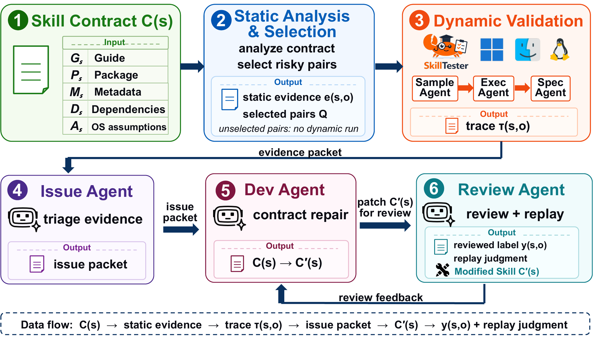

# SkillBridge

🎉 **Our paper has been accepted to ICSE 2027!**

**SkillBridge: Cost-Aware Diagnosis and Repair of Cross-OS Compatibility Defects in Agent Skills**

SkillBridge studies how reusable agent skills can fail across operating systems
when their guide text, package surface, metadata, dependencies, and execution
assumptions do not agree. The paper presents a workflow that combines static
contract analysis, targeted dynamic validation, root-cause review, and repair
replay.

This repository contains the complete SkillBridge pipeline under `code/`, from
cross-OS sampling and execution through review, repair, replay, and validation.
Raw experiment records are organized under `data/raw/`. Paper-specific summary
tables, figure renderers, raw execution archives, and private databases are not
part of the Git working tree. This public release is available through the
repository.
