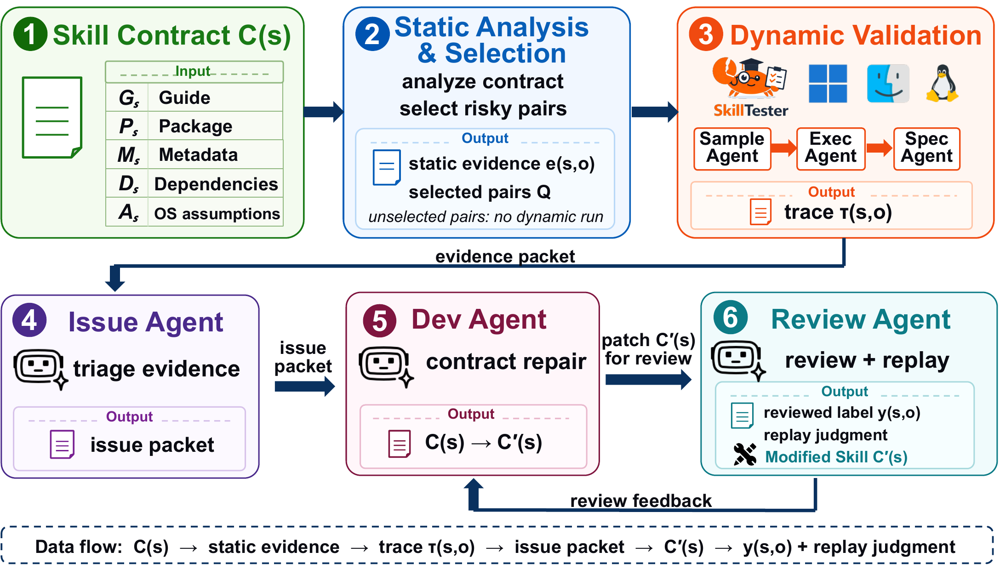

# SkillBridge

🎉 **Our paper has been accepted to ICSE 2027!**

**SkillBridge: Cost-Aware Diagnosis and Repair of Cross-OS Compatibility Defects in Agent Skills**

SkillBridge studies how reusable agent skills can fail across operating systems
when their guide text, package surface, metadata, dependencies, and execution
assumptions do not agree. The paper presents a workflow that combines static
contract analysis, targeted dynamic validation, root-cause review, and repair
replay.

This repository is currently a landing page for the project. The code and data
are undergoing external audit and will be released in a later artifact update.
No source code, private traces, credentials, or research data are included in
this initial release.
